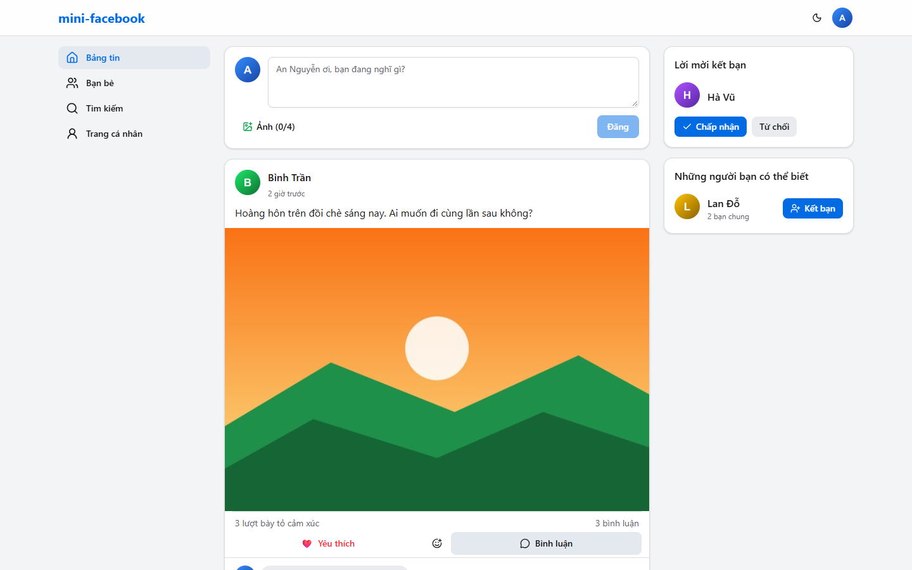
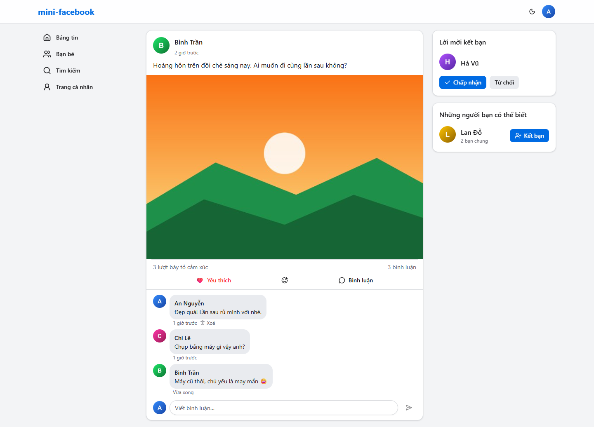
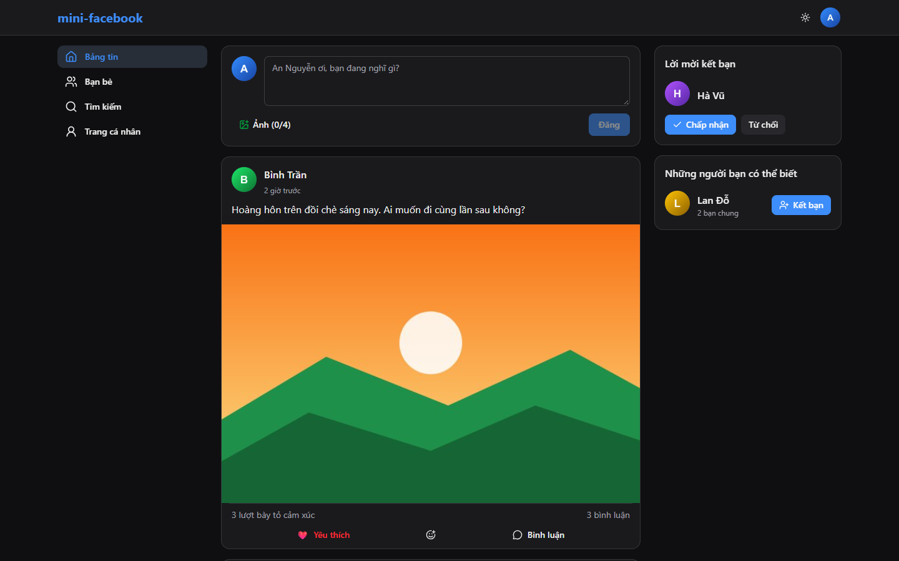
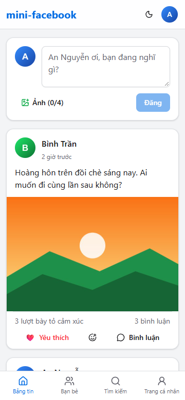

# mini-facebook

Mạng xã hội thu nhỏ: **React 19 + Spring Boot 4 + MySQL 8.4**. Quy tắc phát triển và thiết kế:
[CLAUDE.md](CLAUDE.md).

| Bảng tin | Bài viết + bình luận |
|---|---|
|  |  |
| **Giao diện tối** | **Điện thoại (360px)** |
|  |  |

## Tính năng

- **Tài khoản**: đăng ký, đăng nhập, đăng xuất; phiên JWT 15 phút + refresh token xoay vòng theo family.
- **Hồ sơ**: sửa tên/giới thiệu, đổi ảnh đại diện, xem bài của một người, tìm người theo tên (không cần dấu).
- **Bài viết**: văn bản và/hoặc tối đa 4 ảnh, sửa nội dung, xoá; bảng tin cuộn vô hạn.
- **Tương tác**: 6 loại reaction (1 reaction/người/bài), bình luận, xoá bình luận.
- **Bạn bè**: gửi/huỷ lời mời, chấp nhận/từ chối, huỷ kết bạn, danh sách bạn, gợi ý bạn của bạn.
- Bài viết chỉ hiển thị cho tác giả và bạn bè; giao diện sáng/tối; responsive từ 360px.

## Yêu cầu

- **JDK 21 trở lên** (khuyến nghị Temurin 21) và Maven 3.9+
- **Node 22 LTS** trở lên
- **Docker Desktop** (+ WSL2 trên Windows): MySQL cho dev và Testcontainers cho test
- Git hook: [lefthook](https://lefthook.dev) (cài sẵn qua `npm install` trong `frontend/`) và
  [gitleaks](https://github.com/gitleaks/gitleaks) (`winget install Gitleaks.Gitleaks` / `brew install gitleaks`)

## Chạy lần đầu (≈ 10 phút)

**1. Biến môi trường** — sao chép và điền giá trị:

```bash
cp .env.example .env
# DB_PASSWORD, DB_ROOT_PASSWORD: mật khẩu tuỳ ý
# JWT_SECRET, MEDIA_SIGNING_SECRET: mỗi cái một chuỗi ngẫu nhiên 32 byte:
openssl rand -base64 32
```

**2. MySQL**

```bash
docker compose up -d
```

**3. Backend** (http://localhost:8080) — profile `dev` bật Swagger ở `/swagger-ui.html`,
profile `demo` tạo dữ liệu mẫu khi DB còn trống:

```bash
cd backend
set -a && . ../.env && set +a          # Git Bash / macOS / Linux
mvn spring-boot:run -Dspring-boot.run.profiles=dev,demo
```

PowerShell thay dòng `set -a ...` bằng:

```powershell
Get-Content ..\.env | Where-Object { $_ -match '^\s*[^#].*=' } | ForEach-Object {
  $k, $v = $_ -split '=', 2; Set-Item "env:$k" $v
}
```

**4. Frontend** (http://localhost:5173, proxy `/api` → 8080):

```bash
cd frontend
npm install
npm run dev
```

**5. Đăng nhập** bằng tài khoản demo `an@demo.local` / `demo12345` (các tài khoản khác:
`binh@`, `chi@`, `dung@`, `ha@`, `minh@`, `lan@demo.local`, cùng mật khẩu).

**6. Git hook** (một lần sau khi clone, trước commit đầu tiên):

```bash
npx --prefix frontend lefthook install
```

## Kiểm tra

```bash
cd backend && mvn verify      # Spotless, test (Testcontainers MySQL), SpotBugs + FindSecBugs, JaCoCo ≥ 70% cho *Service
cd frontend && npm run check  # tsc, ESLint (a11y, react-hooks, no-danger), Prettier, Vitest
```

CI (`.github/workflows/ci.yml`) chạy cả hai cùng gitleaks trên mỗi push/PR.

## Cấu trúc

```
backend/   Spring Boot — package theo tính năng: auth, user, post, comment, reaction, friendship, media
           db/migration/V1__init.sql là schema chuẩn (Flyway, ddl-auto=validate)
frontend/  React + Vite — src/api (axios), src/features/*, src/components/ui (shadcn/ui)
docs/      review-log.md, deploy/nginx.conf, screenshots/
```

## Bảo mật (tóm tắt)

- Quyền xem bài chỉ quyết định ở `PostAccessPolicy`; không xem được → 404, xem được nhưng không
  phải chủ → 403.
- Access token trong bộ nhớ; refresh token trong cookie `HttpOnly; Secure; SameSite=Strict`, DB chỉ
  lưu SHA-256; dùng lại token cũ sau 10 giây → thu hồi cả family.
- Ảnh: nhận diện bằng magic bytes, chặn > 40 megapixel trước khi giải nén, mã hoá lại (bỏ EXIF/GPS),
  ảnh bài viết phục vụ qua URL ký HMAC hết hạn sau 1–2 giờ.
- Rate limit đăng nhập/đăng ký/refresh/tạo nội dung; CSP, `nosniff`, `Referrer-Policy`.

## Triển khai

Frontend và API phải cùng domain qua reverse proxy HTTPS (cookie `SameSite=Strict; Secure`).
Xem [docs/deploy/nginx.conf](docs/deploy/nginx.conf); chạy backend với profile `prod`
(`server.forward-headers-strategy=native` để rate limit thấy IP thật). Rate limit nằm trong bộ nhớ
nên chỉ đúng khi chạy **1 instance**.
